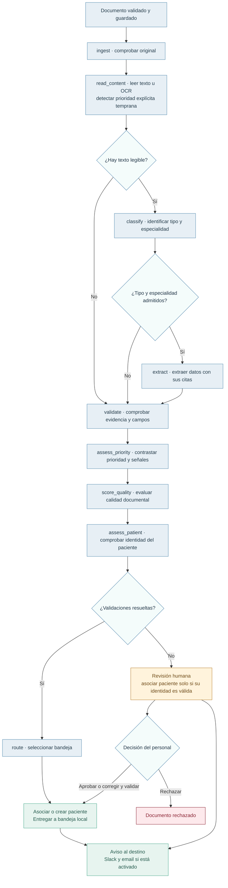

<p align="center">
  
</p>

# MediFlow — Gestión inteligente de documentos clínicos

> **Hackathon ONE G10 · Equipo 20**<br>
> Una plataforma web que transforma documentos dispersos en información organizada, trazable y conectada con cada paciente.

## Acerca de MediFlow

Una receta, una orden médica, un informe de laboratorio o una epicrisis pueden llegar en formatos diferentes y terminar en bandejas separadas. MediFlow ayuda a leerlos, identificar qué contienen, relacionarlos con su paciente y dirigirlos al área correspondiente.

La inteligencia artificial apoya la lectura y extracción de información. El sistema contrasta los datos con el texto del documento y solicita revisión humana cuando encuentra información incompleta, ilegible o contradictoria. Cada paso conserva un estado y un historial consultable.

## Acceso a la plataforma

**[Abrir MediFlow Cloud](https://mediflow-app-zhyw.onrender.com)**

| Espacio | Acceso Directo | ¿Qué permite? |
| --- | --- | --- |
| **Personal Autorizado & Médico** | [Acceso Administrativo](https://mediflow-app-zhyw.onrender.com/administradores) | Gestionar documentos, pacientes, bandejas clínicas, triage de IA y revisión según permisos. |
| **Pacientes Registrados** | [Iniciar Sesión Paciente](https://mediflow-app-zhyw.onrender.com/login) | Consultar los documentos asociados a su identidad y descargar originales. |
| **Nuevos Pacientes** | [Registro de Paciente](https://mediflow-app-zhyw.onrender.com/registro) | Registrarse con país, número de identificación, email y contraseña. |
| **Documentación de API** | [Swagger UI](https://mediflow-backend-1ulf.onrender.com/docs) | Explorar y probar interactivamente los endpoints del backend FastAPI. |

### Credenciales de Prueba para Evaluadores y Jurado

Para facilitar la evaluación de la plataforma sin necesidad de registrar nuevas cuentas, se han habilitado los siguientes accesos verificados:

#### 1. Personal Clínico y Administrativo (Ingresar en /administradores)
| Rol | Correo Electrónico | Contraseña | Capacidades |
| :--- | :--- | :--- | :--- |
| **Superadministrador** | dmin@mediflow.com | AdminMediflow2026! | Control total, configuración de canales Slack y gestión de destinos. |
| **Médico / Operador** | doctor@mediflow.com | DoctorMediflow2026! | Carga de documentos clínicos, consulta de pacientes y bandejas. |
| **Revisor Humano** | 
evisor@mediflow.com | RevisorMediflow2026! | Cola de revisión HITL para validar o reclasificar documentos observados. |

#### 2. Portal de Pacientes (Ingresar en /login)
| Rol | País | Cédula / Identificación | Contraseña | Nombre |
| :---: | :---: | :--- | :--- | :--- |
| **Paciente** | **Colombia (CO)** | 1099900101 | Paciente2026! | Carlos Mendoza |

## Qué hace diferente a MediFlow

### Un sistema, 11 países

MediFlow reconoce que una identificación no tiene la misma estructura en todos los países. Al ingresar un documento o registrar una cuenta, utiliza el país seleccionado para interpretar y validar el formato correspondiente, incluyendo etiquetas impresas como DNI, CC, CPF, RUN o CURP.

| País | Identificaciones reconocidas |
| --- | --- |
| Argentina | DNI y CUIL |
| Bolivia | Cédula de identidad |
| Brasil | CPF |
| Chile | RUN / RUT |
| Colombia | Cédula de ciudadanía / CC y NUIP |
| Ecuador | Cédula de identidad |
| México | CURP |
| Paraguay | Cédula de identidad |
| Perú | DNI |
| Uruguay | Cédula de identidad |
| Venezuela | Cédula con prefijo V o E |

La validación comprueba la estructura admitida por la aplicación; no sustituye una verificación de identidad ante organismos oficiales. El país forma parte de la identidad para evitar confundir números iguales emitidos en lugares diferentes.

### El paciente se registra y sus documentos se conectan

Cuando MediFlow identifica un nombre y una identificación compatibles, respaldados por el documento, crea automáticamente un registro del paciente si todavía no existe. El registro queda segmentado por **país, tipo de identificación y número de documento**.

Si llegan más documentos con esa misma identidad, se asocian al paciente existente. Cuando hay identificaciones ambiguas o nombres que no coinciden, el sistema solicita revisión antes de establecer una asociación insegura.

Así, una receta y un resultado de laboratorio pueden formar parte del mismo expediente documental, aunque se hayan cargado en momentos distintos.

### Un portal para que cada persona encuentre sus documentos

La plataforma incluye registro e inicio de sesión para pacientes. Desde su portal, cada persona puede consultar de forma centralizada los documentos que el sistema haya asociado a su identidad y abrir sus originales.


El personal cuenta con un espacio separado, con roles y permisos para definir quién puede cargar, consultar, procesar, corregir o administrar información.

### Avisos oportunos con Slack y una base preparada para email

**Slack está integrado al flujo de trabajo.** MediFlow genera avisos cuando detecta una prioridad urgente o crítica explícita, cuando un documento llega a una bandeja y cuando requiere revisión humana. Los mensajes permiten abrir el documento en la web.

Los avisos se guardan en una cola persistente y el worker los envía en segundo plano, sin esperar a que termine todo el análisis. Su estado permite distinguir avisos pendientes, enviados y fallidos, con reintentos cuando corresponde. La recepción depende de la disponibilidad de Slack y de la configuración de sus canales.

**Email queda preparado y desactivado por defecto.** Cada destino puede guardar uno o varios destinatarios separados por comas. La sección **Configuración SMTP**, dentro de Variables de Configuración, permite guardar servidor, puerto, seguridad TLS, usuario, contraseña y remitente. Para utilizar este canal en el futuro basta completar esa configuración, definir destinatarios y activar el envío explícitamente.

Los avisos por email cubren entrega a bandeja y revisión humana. Incluyen un enlace a MediFlow, sin adjuntar documentos ni campos clínicos extraídos. Guardar credenciales con el envío desactivado no genera correos.

### Información que se puede comprobar

Los campos extraídos incluyen citas del texto original. El personal puede contrastar el resultado con el documento, consultar sus páginas y revisar los motivos por los que un campo necesita atención.

Las revisiones conservan la acción realizada, su fecha, las notas, el resultado previo y la cuenta autenticada que intervino. Los originales y las instantáneas de resultados se almacenan en Cloudflare R2; una huella SHA-256 permite comprobar la integridad del original antes de procesarlo.

### Flexibilidad para el trabajo diario

- **Varios formatos de entrada:** PDF, JPG, PNG y texto clínico. Los documentos escaneados se leen mediante OCR, que convierte la imagen en texto.
- **Clasificación documental:** recetas, órdenes, laboratorios, informes de imágenes, certificados, epicrisis y documentos cardiorrespiratorios, entre otros tipos del catálogo.
- **Bandejas configurables:** reglas por tipo de documento y especialidad para dirigirlo al destino correspondiente.
- **Revisión asistida:** aprobar, corregir o rechazar con acceso al original y a las incidencias detectadas.
- **Calidad configurable:** campos requeridos y umbrales de calidad por tipo documental.
- **Elección de proveedor de IA:** Gemini u OpenAI mediante configuración administrativa.
- **Continuidad del procesamiento:** trabajos persistentes, progreso por etapa, reintentos y recuperación después de interrupciones.
- **Búsqueda y seguimiento:** filtros por país, paciente, estado, prioridad, tipo documental, especialidad, fechas y calidad.

## Cómo avanza un documento con LangGraph

LangGraph coordina las etapas del análisis y sus decisiones. Primero se valida y guarda el original. Después, cada nodo realiza una tarea concreta; las etapas posteriores reciben los resultados de las anteriores.



Las alertas urgentes o críticas explícitas pueden programarse desde la lectura inicial, antes de terminar la clasificación. Si el proveedor falla, se conserva el avance, se registra el fallo y se permite reintentar; al agotar los intentos, el documento pasa a revisión humana. Una prioridad por defecto no se presenta como confirmada tras un fallo de IA.

La prioridad se basa en declaraciones y evidencia del documento. **MediFlow organiza y prioriza el trabajo documental; no diagnostica ni reemplaza el criterio del personal clínico.**

## Estados claros para saber qué ocurre

| Estado | Significado para quien usa MediFlow |
| --- | --- |
| `RECIBIDO` | Se inició el ingreso del documento. |
| `VALIDADO` | El archivo o texto superó la validación de entrada. |
| `CLASIFICADO` | Se identificaron su tipo y especialidad. |
| `EXTRAIDO` | Se obtuvieron datos y citas de respaldo. |
| `EVALUADO` | Se ejecutó la validación documental. |
| `EN_REVISION_HUMANA` | Hay incidencias o intentos agotados que requieren intervención. |
| `RESUELTO` | La revisión humana aprobó o corrigió las incidencias. |
| `ENRUTADO` | Se seleccionó la bandeja de destino. |
| `ENTREGADO` | El documento está disponible en la bandeja local de MediFlow. |
| `RECHAZADO` | No se admitió en la validación inicial o fue rechazado en revisión. |
| `FALLO_TECNICO` | Una etapa no pudo completarse y se conserva el avance para recuperación. |

El estado del documento, su prioridad y el estado del aviso son datos diferentes. Un documento entregado puede tener una notificación todavía pendiente. La entrega local significa disponibilidad en MediFlow; no acredita una integración con un sistema hospitalario externo.

## Arquitectura del monorepo

MediFlow reúne una web Angular, una API FastAPI, un worker en segundo plano y PostgreSQL. Cloudflare R2 conserva archivos y respaldos; los proveedores de IA realizan OCR, clasificación y extracción.

```text
G10-Equipo20-MediFlow/
├── backend/
│   ├── app/
│   │   ├── api/              # Documentos, pacientes, cuentas y administración
│   │   ├── core/             # Países, catálogo, permisos, configuración y límites
│   │   ├── graph/            # Flujo documental coordinado por LangGraph
│   │   ├── models/           # Documentos, pacientes, trabajos y notificaciones
│   │   ├── providers/        # Gemini y OpenAI
│   │   ├── repositories/     # Persistencia de documentos
│   │   ├── schemas/          # Contratos y validación de datos
│   │   ├── services/         # OCR, revisión, pacientes, R2, Slack y SMTP
│   │   ├── main.py           # API FastAPI
│   │   └── worker.py         # Procesamiento, respaldos y envío de avisos
│   ├── migrations/           # Evolución de PostgreSQL con Alembic
│   ├── verification/         # Pruebas, documentos sintéticos y verificaciones
│   └── Dockerfile
├── frontend/
│   ├── src/app/              # Portal, login, documentos, revisión y configuración
│   ├── src/styles.css        # Identidad visual y diseño adaptable
│   ├── nginx.conf            # Web y conexión con la API
│   └── Dockerfile
├── docs/assets/              # Recursos visuales de la documentación
├── docker-compose.yml        # API, worker, web, PostgreSQL y entorno de pruebas
├── LICENSE
└── README.md
```

## Identidad visual

La interfaz utiliza una base azul pizarra, acentos azules y fondos claros, con colores diferenciados para estados y prioridades.

| Color | Referencia | Uso en esta versión |
| --- | --- | --- |
| Azul pizarra | `#243C4C` | Identidad principal, textos y navegación. |
| Azul clínico | `#5289AD` | Acentos, acceso y elementos destacados. |
| Blanco menta | `#F4FCFB` | Fondo general de la aplicación. |
| Azul suave | `#E7EFF5` | Superficies y elementos de apoyo. |
| Verde | `#44A789` | Indicadores activos y confirmación. |
| Rojo vino | `#8F2434` sobre `#FDE9EC` | Prioridades urgente y crítica. |

## Licencia

Este proyecto está bajo la Licencia MIT. Consulta [LICENSE](LICENSE) para más detalles.
